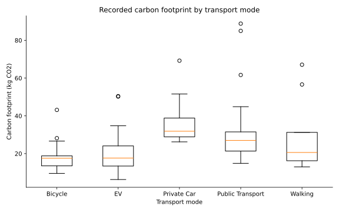

# CityScape Carbon Analysis

A Python workflow for exploring recorded carbon footprints across transport modes. It produces group summaries, confidence intervals, an ANOVA comparison and a boxplot.

## Features

- Validates transport labels and numeric, nonnegative footprint values.
- Reports complete observations and excluded rows.
- Calculates counts, means, medians, sample standard deviations and 95% t confidence intervals.
- Runs one-way ANOVA and a median-centered Levene test when groups have sufficient variation.
- Exports machine-readable results and an SVG chart.
- Includes four tests covering known statistics, missing values, invalid inputs and output generation.

## Results

All 100 input records have complete values across five transport groups. The overall recorded mean is **26.75 kg CO2**.

| Transport mode | Records | Mean kg CO2 | 95% CI for mean |
| --- | ---: | ---: | ---: |
| Bicycle | 13 | 18.90 | 13.35–24.45 |
| EV | 29 | 20.02 | 15.93–24.11 |
| Private Car | 14 | 36.35 | 29.66–43.04 |
| Public Transport | 36 | 30.74 | 25.20–36.27 |
| Walking | 8 | 29.12 | 11.86–46.37 |



The one-way ANOVA gives F(4,95) = 5.206, p = 0.000778. The median-centered Levene test gives p = 0.6995. These exploratory tests describe this sample. ANOVA assumes independent observations, approximately normal within-group errors and equal variances; the Levene result does not prove those assumptions. No pairwise significance conclusions are made.

The footprint field has no stated measurement period or emissions boundary. Treat it as a recorded value grouped by transport mode, not a per-trip emissions estimate or evidence that changing transport causes a particular reduction. Sampling representativeness is not established.

## Run

Python 3.10 or later:

```bash
python -m pip install -r requirements.txt
python analyze.py data/CityScape_Dataset.csv --output results
python -m unittest -v test_analysis
```

Input is a comma-delimited CSV with `Mode_of_Transport` and `Carbon_Footprint_kgCO2`. Other columns are ignored. Blank required fields are excluded and counted. Invalid numeric values raise an error. Groups with one observation have no standard deviation or confidence interval.

Customer or citizen-level input is not bundled. Unit tests use synthetic observations and can run without the source dataset.

## Outputs

- [Transport summaries](results/transport_summary.csv)
- [Analysis statistics](results/analysis.json)
- [Verification results](results/verification.txt)

Built with pandas, NumPy, SciPy and Matplotlib.
